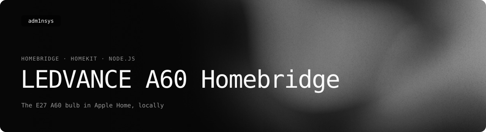

<picture>
  <source media="(prefers-color-scheme: light)" srcset=".github/readme/banner-light.svg">
  
</picture>

<p>
  <a href="https://adm1nsys.github.io/Ledvance-A60-Plugin/"></a>
  <a href="https://www.npmjs.com/package/homebridge-ledvance-a60"></a>
  <a href="https://github.com/adm1nsys/Ledvance-A60-Plugin/releases/latest/download/homebridge-ledvance-a60.zip"></a>
  <a href="https://adm1nsys.github.io/Ledvance-A60-Plugin/#versions"></a>
  <a href="https://adm1nsys.github.io/Ledvance-Smart-WiFi-E27-A60-Local-Control/"></a>
  <a href="LICENSE"></a>
</p>

**homebridge-ledvance-a60** is a [Homebridge](https://homebridge.io) plugin that brings the LEDVANCE Smart+ WiFi E27 A60 RGBW bulb into Apple HomeKit, controlled over the local network without the LEDVANCE cloud.

In the Home app the bulb is a normal light: on/off, brightness, colour temperature and colour. Changes made elsewhere (for example in the LEDVANCE app) show up within a few seconds.

## How it works

The plugin does not speak the Tuya protocol itself. It calls [`LedvanceE27A60.py`](homebridge-ledvance-a60/LedvanceE27A60.py) — the command-line tool from my [Ledvance-Smart-WiFi-E27-A60-Local-Control](https://github.com/adm1nsys/Ledvance-Smart-WiFi-E27-A60-Local-Control) repository, shipped inside the plugin as a component — and reads the state from it every few seconds. Hue and saturation changes that HomeKit sends a few milliseconds apart are combined into one command.

## Requirements

- Homebridge 1.6 or newer, Node.js 14.17 or newer
- **Python 3 with TinyTuya** on the same machine: `pip3 install tinytuya` — the plugin does not install it
- the bulb's device ID and local key (see the [CLI's README](https://github.com/adm1nsys/Ledvance-Smart-WiFi-E27-A60-Local-Control#requirements))

## Install

Search for `homebridge-ledvance-a60` in the Homebridge UI, or:

```bash
npm install -g homebridge-ledvance-a60
```

## Configuration

Add an accessory to Homebridge's `config.json` (the plugin has no settings form yet):

```json
"accessories": [
  {
    "accessory": "LedvanceA60",
    "name": "Living room",
    "virtualId": "a1b2c3d4e5f6g7h8ijklmn",
    "localKey": "WQ!zYx8#kLp3vBn@",
    "ip": "192.168.0.238",
    "mac": "aa:bb:cc:dd:ee:ff",
    "pollInterval": 4000
  }
]
```

| Field | Required | Meaning |
|---|---|---|
| `accessory` | yes | always `LedvanceA60` |
| `name` | no | name in the Home app (default "Ledvance A60") |
| `virtualId` | yes | Tuya device ID |
| `localKey` | yes | Tuya local key |
| `ip` | one of the two | fixed IP of the bulb — recommended (reserve it in the router) |
| `mac` | one of the two | without `ip`, the plugin finds the bulb by MAC in the ARP table; this only works once the Homebridge machine has talked to the bulb |
| `pollInterval` | no | how often the state is read, in ms (default 4000) |

## Limits

- Each status read starts a short Python process; on a very small machine a longer `pollInterval` helps.
- Tested in 2025 with my own bulb (firmware V1.5.32) and Homebridge; the version on npm is 0.1.0. The repository has had documentation and log-message fixes since, not yet published to npm.

## License

MIT. Not affiliated with LEDVANCE, Tuya or Apple.
